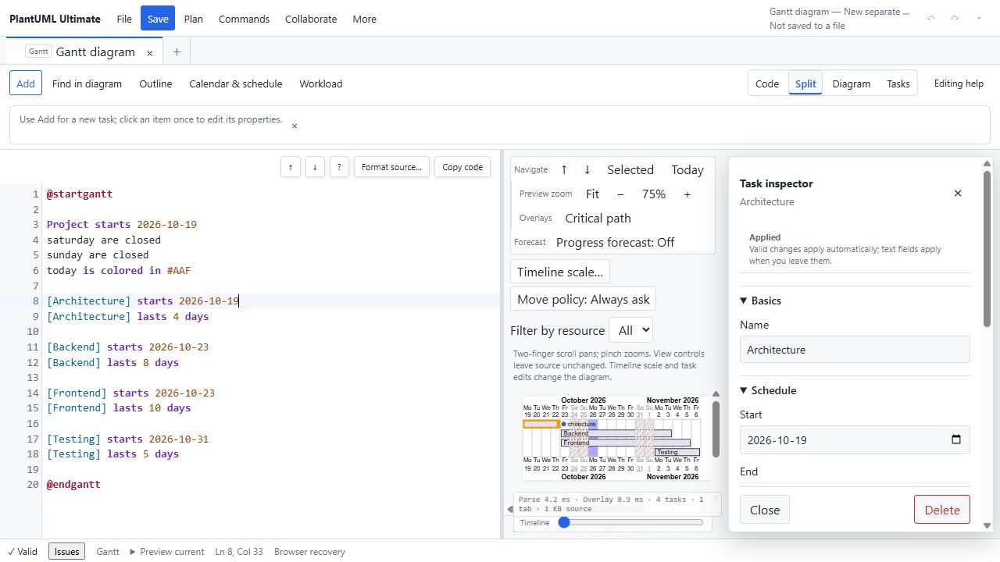

# App review — 26 October 2026

Local fixes and validation are recorded in [the remediation report](REMEDIATION.md). The findings below preserve the original audit evidence.

Reviewed local revision `049512e`. This is an audit, with no application changes or deployment. Prior audit findings were treated as historical, not assumed to remain open.

The strongest findings concern collaboration recovery and ownership, followed by Jira partial publishing. No successful XSS, cross-room authorization bypass, or credential exfiltration was demonstrated.

| Priority | Finding                                                              | Evidence                                                   |
| -------- | -------------------------------------------------------------------- | ---------------------------------------------------------- |
| P1       | Refresh loses the room creator's ability to revoke access            | Code tracing                                               |
| P1       | Valid large rooms cannot synchronize normally when editors reconnect | Reproduced client protocol mismatch                        |
| P2       | Revocation and permanent errors promise eventual synchronization     | Reproduced with WebSocket test double                      |
| P2       | Jira hides successful writes when a later batch fails                | Reproduced with mocked HTTP responses                      |
| P2       | Collaboration has no application-level abuse budget or expiration    | Code/config review; production edge settings unknown       |
| P2       | Nine dependency entries have published advisories                    | Current npm audit; exploitability differs by configuration |

## 1. Room ownership disappears on refresh

`apps/web/src/use-collaboration-lifecycle.ts:189` creates an owner token only when creating a new room. It exists in the session's in-memory credentials. At line 325 the address is replaced with an ordinary editor share URL. On reload, line 369 reads this editor link, and joining an existing room does not restore an owner token. Repository search found no owner credential persistence or recovery path.

Consequently, create room → refresh → rejoin leaves the creator as an editor without the revoke control. Closing the last owner tab has the same consequence. Old links remain valid and the server has no room expiry. This undermines the promised ability to withdraw access after a link is leaked. This is a code-confirmed lifecycle defect, not a live production-room test.

**Fix:** Provide an explicit private owner recovery credential or scoped owner-session persistence, separate from all share links. Make expiry and the consequences of leaving visible. Test create → reload → revoke, and never place the owner token in editor/viewer links.

## 2. Reconnecting editors exceed the incoming size limit

The Worker accepts individual updates up to 1,000,000 bytes but stores encoded room state up to 1,900,000 bytes (`apps/collaboration-worker/src/index.ts:6`). On initial synchronization and reconnect, `apps/web/src/collaboration-session.ts:187` sends `Y.encodeStateAsUpdate(this.document)` without a state vector or chunking.

The probe creates a schema-valid 400,000-character source using two approximately 600 KB updates. Its complete state is approximately 1.2 MB, below the room limit. Receiving that state causes the client to send it back as one message over 1 MB, which the Worker rejects at line 307. Thus an otherwise valid room can enter a connect/disconnect loop for editors even without additional edits. The probe exercises the actual client and schema validator with a test-double socket; the server rejection is established from its size check, not a live Worker reproduction.

**Fix:** Use a state-vector synchronization exchange and bounded delta messages, or deliberately align snapshot and message limits. Add a Worker/client integration test covering large existing rooms and offline changes.

## 3. Permanent failures are presented as temporary outages

`apps/web/src/collaboration-session.ts:157` recognizes `room-revoked`, but only closes the socket. Line 194 retries every close without inspecting its code. Codes 4001 (revoked), 1009 (too large), and 1007 (invalid update) all enter the same retry path. `CollaborationDialog.tsx:125` then says “Offline · edits will synchronize after reconnecting”. Existing live collaboration tests even expect the generic offline label after revocation.

All three codes reproduced the retry behavior. For revoked rooms, that promise can never be fulfilled. For rejected state, retries resend the same local state.

**Fix:** Separate offline/retrying from revoked, access-denied, oversized, and invalid-state conditions. Preserve local edits, offer Save a local copy and Join a new room, and stop automatic retries for explicit permanent failures. For failed handshakes, which browsers do not expose as readable HTTP responses, add a safe status/error protocol or bounded fallback messaging.

## 4. Jira partial publishing loses its success record

`apps/web/src/jira-client.ts:127` publishes in groups of 25 and accumulates results locally. If a later request throws, earlier results are discarded. `JiraDialog.tsx:317` shows only the error message. The Worker also writes issues sequentially and can lose earlier results if a later upstream request throws.

The probe simulates 26 updates: the first 25 succeed, and the next request returns 503. The caller receives only “Service temporarily unavailable”, with no successful issue list. The UI has good partial-failure messaging when results are returned normally, but that does not cover request-level failures. Users may repeat already successful writes or misunderstand what changed in Jira.

**Fix:** Return structured partial results with confirmed successes and uncertain outcomes. Require a fresh read before retrying uncertain writes. Preserve progress across batches and display issue-level results. A timeout must not be presented as proof that a remote write failed.

## 5. Collaboration abuse controls need an explicit budget

The public route calls `getByName` for any correctly shaped room ID (`apps/collaboration-worker/src/index.ts:376`). Room creation relies on caller-generated tokens and an allowed Origin. A non-browser client can supply that Origin; it is not authentication. No application-level creation rate limit, per-room connection cap, per-socket message budget, or idle expiration was found.

Every presence message broadcasts the whole participant list, and every binary update clones, validates, encodes, and persists the document. Message-size limits are useful but do not limit message frequency or room count.

**Fix:** Add creation throttling, room/socket budgets, presence coalescing, and documented expiry/cleanup. Verify production edge rules before judging effective exposure. This is an application-layer abuse/cost risk; no load attack was attempted, and externally configured protection may reduce it.

## 6. Dependency advisories need maintenance, not exaggerated exploit claims

Saved evidence: `npm-audit.json`. npm reports **9 affected dependency entries: 1 critical, 4 high, 4 moderate**. These counts include transitive effects, not nine independent exploitable vulnerabilities.

Installed DOMPurify is 3.4.16. The [critical template/shadow-root advisory](https://github.com/advisories/GHSA-cg2g-xh64-v4q7) and [high IN_PLACE hook advisory](https://github.com/advisories/GHSA-mrv2-3pqr-j5jr) identify 3.4.17 as patched. The reviewed sanitizer uses string input, SVG profiles, and RETURN_DOM_FRAGMENT, but does not enable SAFE_FOR_TEMPLATES, IN_PLACE, or the affected hooks. The third listed DOMPurify advisory requires an XHTML parser configuration absent here. These advisories justify updating a security boundary; they do not establish exploitable XSS in this application.

Other affected entries include Vite, Vitest/@vitest/mocker, Miniflare/Wrangler, Zod, and the Cloudflare test plugin. Review development-tool exposure separately from shipped browser code. Avoid blindly accepting npm's suggested major downgrades.

**Fix:** Update to patched compatible releases, regenerate the lockfile, rerun SVG/CSP and Worker tests, and review remaining transitive findings individually.

## Usability improvements

These are recommendations based on a local browser walkthrough and component review, not claims of functional failure or user-study results.

1. **Preserve useful canvas space when an inspector opens.** At 1280 × 720, the code editor occupies about half the width, the inspector takes 340 px, and the remaining narrow preview stacks controls above a tiny chart. The diagram itself occupies roughly 230 × 110 px in the captured example. Rebalance the split against available width, collapse secondary preview controls, and offer an obvious temporary focus-on-diagram action. Keep zoom/fit visible; place overlays, filters, and move policy behind a compact options control.
2. **Simplify the first decision.** The creation dialog contains seven diagram types, ten example cards, destination/content/name fields, personal-starter import/export, and learning content in one scrollable surface. Start with Create / Open / Examples. Reveal type-specific examples after a type is chosen; hide the single-option destination selector when there is no open document. Default keyboard focus should land on a meaningful action rather than that single-option selector.
3. **Make commit behavior consistent and unmistakable.** Task fields say they apply automatically on blur, while Calendar & schedule requires Apply. Both initially show “Applied”. Keep a persistent, concise mode indicator: “Auto-save properties” versus “Unapplied changes — Apply / Cancel”. Consider a common explicit apply preference across panels. Validate this with keyboard editing and accidental-close scenarios.
4. **Give long Jira operations progress and a safe exit.** Client and upstream fetches have no explicit deadline; the dialog remains busy while awaiting them. Show pages/issues processed and support cancellation before publishing. During publishing, clearly explain that closing the panel does not undo requests, and retain a results view when the panel is reopened.

## Validation and limits

- **9 Chromium browser tests passed:** save-status (3), security (4), and start-experience (2).
- **46 existing focused unit tests passed:** preview security, file saving, and workspace storage.
- **5 audit probes passed:** three permanent close codes, oversized reconnect snapshot, and Jira partial-batch result loss. They intentionally assert current defective behavior and should be inverted/replaced when fixes land.
- Local UI inspection covered startup, Gantt split view, creation menus, task creation form, calendar panel, and task inspector.
- Initial runs encountered sandbox socket/temp-file restrictions; permitted runs outside that sandbox completed. Those initial failures were environmental, not app defects.
- No full-suite run, Firefox/WebKit/mobile walkthrough, production security configuration inspection, live Jira publishing, production collaboration manipulation, or exhaustive seven-diagram interaction audit was performed.

Suggested order: repair collaboration ownership and synchronization; fix permanent-error and Jira partial-result reporting; update dependencies and confirm abuse controls; then improve canvas layout and first-use flow.
