# Jira-linked Gantt tasks

A lightweight, read-only way to show Jira status on a Gantt chart. Unlike the Jira import in
the Jira dialog, a linked task stores only the issue link in the diagram. Jira stays the source
of truth for status, summary, assignee and dates; the diagram owns the schedule.

## Link a task

Add a `links to` line with the issue's browse URL:

```plantuml
@startgantt
Project starts 2026-09-01
[Build API] as [build] lasts 10 days
[build] links to [[https://acme.atlassian.net/browse/APP-123 APP-123]]
@endgantt
```

- The link must be `https://<site>/browse/<KEY>-<number>`. Any Jira Cloud site works; nothing is
  tied to a particular company.
- The file is still valid PlantUML and renders in any PlantUML tool as a normal hyperlink.
- Tasks created by the full Jira import (alias `jira_<id>`) are not treated as linked.

## Connect once

Statuses only load for sites you connected in the Jira dialog (Plan → Jira…). The site URL in the
link must match a connected site exactly. When it does not, the task shows why instead of a status.

## What you see

| Where                   | What                                                                                                                                                                                                                                                                                                                                                                   |
| ----------------------- | ---------------------------------------------------------------------------------------------------------------------------------------------------------------------------------------------------------------------------------------------------------------------------------------------------------------------------------------------------------------------- |
| Bar                     | A badge beside the bar: ○ grey = To Do, ◐ blue = In Progress, ✓ green = Done, dashed grey ? = unavailable. It sits to the left of the bar, or to the right when the bar starts at the chart's left edge.                                                                                                                                                               |
| "Jira · N linked" bar   | Last-synced time, a **Refresh** button, a **Connect Jira…** button when needed, and a **Show issue keys** toggle that adds a pill with the key (for example `APP-123`) after the bar. The toggle is remembered per browser.                                                                                                                                            |
| Hover or keyboard focus | The normal task card (dates, duration, slack, links) gets a **Jira** section: issue summary, status and assignee, a Blocked note, type and priority, the Jira start and due dates (with a warning when the diagram disagrees), progress, and last update. Rows Jira does not provide are left out. It opens in the same place and closes the same way as for any task. |
| Exports                 | SVG, PNG, PDF and copied images include the badges (and key pills when the toggle is on). The task card is interactive only.                                                                                                                                                                                                                                           |

## When the status is unavailable

The badge is a dashed grey `?` and the Jira section of the task card gives the reason:

- **Not connected to Jira** – connect in the Jira dialog (the bar and the task card offer a button).
- **This Jira site isn't connected** – the link's site is not one you authorized.
- **Issue not found, or you have no access** – wrong key, or your account cannot see it.
- **Couldn't reach Jira** – the integration service did not answer.

## When statuses refresh

On opening a document, after editing links (short delay), when the Jira dialog closes, when you
return to the tab (at most once a minute), and on **Refresh**.

## Limits

- Atlassian Cloud sites only. Self-hosted Jira under a sub-path (`https://host/jira/browse/…`)
  is not recognised.
- "Blocked" means an "is blocked by" link to an issue that is not Done.
- Progress needs time tracking on the issue; the start date uses the site's "Start date" field
  when one can be identified.

## Where it lives

- Link parsing and field extraction: `packages/jira-integration/src/linked.ts`
- Fetching and refresh: `apps/web/src/use-jira-integration.ts`
- Jira details shared with the task card and preview: `apps/web/src/jira-linked-context.tsx`
- Markers (preview and export): `apps/web/src/render/jira-link-marker.ts`
- Tests: `tests/e2e/jira.spec.ts`, `packages/jira-integration/src/linked.test.ts`
